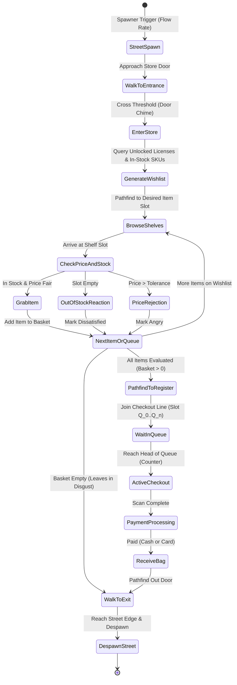

# Pharm Chris — Store Simulator Systems Blueprint
**Author:** @gina (Research Lead)
**Benchmark Reference:** *Pharmacy Manager Simulator* (Android / Mobile, Milky Way Oyun / YouTube `HyFysyRCAxw`)
**Target Tech Stack:** Three.js + TypeScript (WebGL / First-Person 3D + Arcade Hybrid)

---

## Executive Summary

The modern 3D Store Simulator genre (epitomized by *Supermarket Simulator*, *TCG Card Shop Simulator*, and mobile titles like *Pharmacy Manager Simulator*) derives its core compulsion loop from high-tactility, low-friction physical interactions: ordering stock, physically receiving shipments, hand-stocking shelves, operating cash registers, and reinvesting revenue into space, licenses, and automated labor. 

This document deconstructs every subsystem of the benchmark game into an exhaustive technical and gameplay blueprint, adapted for *Pharm Chris* with authentic Nigerian community pharmacy realities (Naira currency `₦`, NAFDAC/PCN compliance, cold-chain backup, and Lagos street dynamics).

```
+------------------------------------------------------------------------------------------+
|                                THE CORE SIMULATOR LOOP                                   |
|                                                                                          |
|  +----------------+      +-------------------+      +------------------+                 |
|  | Management PC  | ---> | Curb Delivery     | ---> | Shelf Stocking   |                 |
|  | (Catalog/Order)|      | (Crate Receiving) |      | & Price Tagging  |                 |
|  +----------------+      +-------------------+      +------------------+                 |
|                                                              |                           |
|                                                              v                           |
|  +----------------+      +-------------------+      +------------------+                 |
|  | Reinvest &     | <--- | Interactive POS   | <--- | Autonomous AI    |                 |
|  | Expand Store   |      | (Scan, Cash, Card)|      | (Browse & Queue) |                 |
|  +----------------+      +-------------------+      +------------------+                 |
+------------------------------------------------------------------------------------------+
```

---

## 1. Physical Logistics Loop (Procurement to Disposal)

### 1.1 Management PC Procurement System
* **Hardware Object:** Interactive desktop computer set on the back-office or dispensary ledger desk. Interacted with via First-Person crosshair raycast (`[E] Open Management PC`).
* **Interface Breakdown:**
  * **Catalog Tab:** Displays unlocked medicine SKUs grouped by license tier (Analgesics, Anti-malarials, Antibiotics, Paediatrics, Cold Chain, Personal Care).
  * **Card Attributes:** Product Icon, Brand Name, Unit Wholesale Cost ($C_{wholesale}$), Recommended Market Retail Price ($P_{market}$), Items per Outer Carton ($N_{pack}$, typically 6, 8, 10, or 12 units per delivery box).
  * **Cart & Freight Logic:**
    * Player adds carton quantities to cart.
    * Flat delivery fee or tier-based freight surcharge (`₦500` - `₦2,000`).
    * Checkout button validates store liquid cash. If funds are sufficient, cash is deducted immediately and an async Delivery Timer is scheduled.
* **Delivery Dispatch Timing:**
  * Mobile benchmark features either an instant curb drop or a 5–30 second courier lead time (e.g. Okada rider sound effect approaching).

### 1.2 Curb Delivery & Pallet Spawning
* **Drop Location:** Designated outdoor receiving zone (curb sidewalk outside store entrance / delivery pallet).
* **3D Spawning Architecture:**
  * Multi-box shipments spawn as corrugated cardboard box meshes (`0.45m x 0.35m x 0.30m`).
  * Boxes stack in neat grid matrices (up to 3x3x3) on the pallet to prevent chaotic physics explosions.
  * Visual Box Decals: Each crate displays its product logo, name, lot number, and a graphic barcode.
* **Data Model on Crate Mesh (`DeliveryCrate3D`):**
  ```typescript
  interface DeliveryCrateData {
    crateId: string;
    productId: string;
    productName: string;
    totalItems: number;       // e.g. 10
    remainingItems: number;   // decrements 10 -> 0
    unitCost: number;
    isColdChain: boolean;
    opened: boolean;
  }
  ```

### 1.3 Carry, Open & Hands Socket Mechanics
* **Player Interaction Modes:**
  1. **Ground Raycast Target:** When aiming at a delivery crate on the ground, hover highlight shows `[E] Pick Up Box`.
  2. **Player Hands Socket:** The box is parented to the camera viewmodel (positioned at `[x: 0, y: -0.32, z: -0.55]` relative to camera). Movement speed is reduced slightly (e.g. 15% carry inertia).
  3. **Unboxing Flap Action:** Player clicks Left Mouse Button (or Tap on mobile) while holding the box to slice tape / open top cardboard flaps. The open box displays individual blister packs/bottles inside.
  4. **Drop Anywhere:** Right Mouse Button drops the box back into the 3D world with raycast ground-alignment.

### 1.4 Shelf Slot Stocking & Price Tagging
* **Shelf Hierarchy:**
  * A Shelving Unit contains 3 to 4 horizontal tiers.
  * Each tier contains 2 to 4 designated **Shelf Slots** (bounding box ~`0.35m x 0.30m x 0.28m`).
* **Slot State Machine:**
  * `EMPTY`: Can accept any product matching the fixture type (Standard Dry Shelf vs Cold Chain Refrigerator).
  * `RESERVED / ASSIGNED`: Has a current product assigned (e.g. *Paracetamol 500mg*). Only boxes of the matching `productId` can transfer items.
* **Stocking Interaction:**
  * With an open box in hand, player looks at a compatible shelf slot. A holographic ghost preview of the next medicine pack appears in green.
  * Pressing Left Mouse Button transfers one medicine unit per click (or holds down for rapid rapid-fire stocking at 0.15s intervals).
  * The pack animates along a parabolic tween from the handheld box into its exact grid position inside the slot (e.g. 2 columns x 4 depth = 8 units max).
  * Sound effect: Crisp plastic carton clack / cardboard rustle.
  * Once `remainingItems === 0`, the box visually appears empty and transitions to `TRASH_STATE`.
* **Price Tag Widget:**
  * Mounted on the shelf edge beneath each slot is a physical digital price tag / plastic label holder.
  * Player looks at tag and presses `[R]` or Clicks to open the **Price Setting Modal**.
  * Shows: **Market Average Price** (e.g. `₦400`), **Unit Cost** (e.g. `₦250`), and editable **Your Retail Price**.
  * Dynamic Customer Reaction Formula:
    $$\text{SatisfactionMultiplier} = \max\left(0, 1 - \frac{P_{retail} - P_{market}}{P_{market} \times 0.3}\right)$$
    * At $P_{retail} \le P_{market}$: 100% buy rate.
    * At $P_{market} < P_{retail} \le 1.25 \times P_{market}$: 60% buy rate, minor complaints.
    * At $P_{retail} > 1.30 \times P_{market}$: Customer refuses item, plays angry emote, leaves speech bubble (`"Too expensive!"`), and leaves shelf empty-handed.

### 1.5 Empty Crate Disposal Loop
* **Disposal Target:** Large industrial dumpster located in the street alleyway outside the store.
* **Mechanic Options:**
  * **Direct Deposit:** Player carries empty box to dumpster and presses `[E] Dispose` inside the trigger zone.
  * **Throw / Toss Mechanic:** Player holds Right Mouse Button to charge throw trajectory arc, releases to toss box into dumpster. Collision with dumpster trigger auto-destroys the box with a satisfying metal slam sound and particle burst.
  * **Litter Penalty (Simulation Juice):** Leaving empty boxes on store floors blocks customer navigation meshes and lowers Store Cleanliness Rating.

---

## 2. Customer Shopping AI & Behavior Architecture

### 2.1 Autonomous Customer Lifecycle State Machine



### 2.2 Customer Archetypes & Wishlist Generation
* Customers spawn along the outdoor pedestrian sidewalk at intervals governed by Store Level and Store Popularity.
* **Customer Profile Structure:**
  * **Patience Meter ($T_{patience}$):** 60 seconds baseline. Decays $1.0x$ per second while in queue, $2.5x$ if queue has $>3$ people.
  * **Price Sensitivity Factor:** $0.9$ (wealthy / hurried) to $1.3$ (bargain hunter / student).
  * **Payment Method Propensity:** 60% Cash (Naira notes), 40% POS Card / Bank Transfer.
  * **Basket Size:** 1 to 4 items (scales with store license expansions).

### 2.3 Navigation & Collision Avoidance
* **Spatial Graph / NavMesh:**
  * 3D Walkable store floor with dynamic NavMesh obstacles for placed shelf units, displays, and checkout counters.
  * Customers use Reciprocal Velocity Obstacles (RVO) or steering behaviors (`seek`, `arrive`, `obstacle_avoidance`) to pass each other without clipping.

### 2.4 Checkout Line Queue Management System
* A queue controller maintains an ordered array of wait waypoints located directly in front of the cash register counter:
  $$Q_0 = [x: 1.2, z: 0.8], \quad Q_1 = [x: 1.2, z: 1.8], \quad Q_2 = [x: 1.2, z: 2.8], \quad Q_3 = [x: 1.2, z: 3.8]$$
* When customer at $Q_0$ completes checkout and leaves, all waiting customers advance simultaneously: $Q_{i} \to Q_{i-1}$.

---

## 3. Interactive Checkout Register Subsystem

### 3.1 Register Station Physical Ergonomics

```
+--------------------------------------------------------------------------------+
|                          FIRST-PERSON REGISTER VIEW                            |
|                                                                                |
|  [Customer Face & Speech Bubble]                                               |
|  "Good day, Pharmacist!"                                                     |
|                                                                                |
|  +--------------------+   +-----------------------+   +---------------------+  |
|  | Counter Conveyor   |   | Cash Register Console |   | POS Card Terminal   |  |
|  | Items from Basket: |   | Pole Display: ₦2,450  |   | [ Insert / Tap ]    |  |
|  | [📦 Malaguard]     |   | Handheld Barcode      |   | Screen: ENTER PIN   |  |
|  | [📦 Amoxil 500mg]  |   | Scanner in Cradle     |   | [ 1 ][ 2 ][ 3 ]     |  |
|  | [📦 Paracetamol]   |   | Drawer: Open / Close  |   | [ OK ][ CANCEL ]    |  |
|  +--------------------+   +-----------------------+   +---------------------+  |
|                                                                                |
|  +--------------------------------------------------------------------------+  |
|  | CASH DRAWER TRAY (When Open):                                            |  |
|  | [₦1000] [₦500] [₦200] [₦100] | [₦50] [₦20] [₦10] [₦5]                   |  |
|  | Click notes/coins to assemble change. Change Due: ₦550                   |  |
|  +--------------------------------------------------------------------------+  |
+--------------------------------------------------------------------------------+
```

### 3.2 Step-by-Step Checkout Interaction Flow

#### Phase A: Item Transfer & Barcode Scanning
1. Customer reaches counter $Q_0$. Their basket empties items onto the conveyor belt/rubber counter mat.
2. Player interacts with register view (`[E] Take Register`). Camera transitions smoothly to a focused workspace framing items, register screen, cash drawer, and POS terminal.
3. Player clicks the handheld optical barcode scanner to pick it up.
4. Aiming scanner at an unscanned item projects a red laser targeting dot/line (`Line2`).
5. Left Click fires laser: audio `BEEP-BOP` (high pitch), item shows a green checkmark decal, and POS Pole Display updates with Item Name and Retail Price.
6. Item shifts from "Pending Scan" zone to "Scanned Bagging" zone.

#### Phase B: Payment Calculation — Cash Branch
1. Customer presents cash bills onto the counter counter tray (e.g. 3x `₦1,000` notes = `₦3,000` for a `₦2,450` bill).
2. Register drawer springs open with mechanical bell chime (`DING-CHING!`).
3. Display reveals: **Total Due (`₦2,450`)**, **Cash Given (`₦3,000`)**, **Change Due (`₦550`)**.
4. **Change Assembly Minigame:**
   * Drawer is partitioned into Nigerian Naira denomination trays:
     * High-Value Banknotes: `₦1,000`, `₦500`, `₦200`, `₦100`.
     * Polymer Notes / Coins: `₦50`, `₦20`, `₦10`.
   * Player clicks bills to add to the customer's change hand:
     * 1x `₦500` bill + 1x `₦50` note = `₦550`.
   * Pressing `[Hand Over Change]` triggers verification:
     * If exact: Customer smiles (`+5 Trust`, instant departure).
     * If underpaid: Customer refuses with buzzer sound: *"You are owing me ₦50!"*
     * If overpaid: Customer takes excess money silently or notes error, store loses margin.

#### Phase C: Payment Calculation — Card / POS Terminal Branch
1. Customer holds out their debit card or places it next to POS.
2. POS Terminal LCD screen illuminates: `SWIPE / INSERT CARD`.
3. Player clicks terminal keypad to enter bill total or presses Green Enter button to accept amount.
4. Customer taps card; processing screen appears (`PROCESSING...`).
5. Network latency simulation (1.2s authentic Nigerian POS delay, chance of "ISSUER NETWORK TIMEOUT" if offline / power bad).
6. Terminal prints thermal receipt strip with paper-tear sound (`Approved: ₦2,450`).

#### Phase D: Customer Hand-off & Bagging
* Scanned items collapse into an authentic Pharm Chris pharmacy paper bag / green polythene carrier bag.
* Customer picks up bag, plays grateful bow/nod animation, and departs along exit path.

---
## 4. Store Progression, Economy & Automation Systems

### 4.1 Tiered Shelf Licenses & Product Progression Tree

| License Tier | Name / Category | Regulatory Requirement | Unlock Cost | Example Medical SKUs | Profit Margin Range |
| :--- | :--- | :--- | :--- | :--- | :--- |
| **Tier 1** | **General OTC & First Aid** | Basic Council Permit | Initial / Free | Paracetamol 500mg, Cotton Wool, Bandages, Methylated Spirit | 20% - 35% |
| **Tier 2** | **Antimalarials & Analgesics** | PCN Premises Registration | `₦45,000` | Lonart DS (Artemether/Lumefantrine), Coartem, Ibuprofen 400mg | 30% - 45% |
| **Tier 3** | **Antibiotics & Antifungals** | Superintendent Pharmacist Stamp | `₦120,000` | Amoxil, Ciprofloxacin, Clavumed (Augmentin), Fluconazole | 40% - 60% |
| **Tier 4** | **Paediatric & Syrups** | NAFDAC Special Verification | `₦250,000` | Vitamin C Syrup, Paracetamol Susp., Baby Gripe Water | 35% - 50% |
| **Tier 5** | **Cold Chain Biologics** | Dual Generator & Refrigerator | `₦600,000` | Mixtard Insulin, Oxytocin, Tetanus Toxoid, Anti-snake Venom | 50% - 80% |

### 4.2 Cold Chain & Refrigeration Mechanics
* **Fixture:** Upright glass-door commercial refrigerator (`RefrigeratedBay3D`) with internal blue LED glow (`0x00E5FF`).
* **Temperature Gauge:** Maintained at `2°C - 8°C`.
* **Spoilage Hazard:** If a player accidentally stocks Tier 5 insulin onto a standard dry wooden shelf, a **Degradation Timer** (90 seconds) starts. After expiration, product turns cloudy/ruined, value drops to zero, and customer purchase causes immediate PCN regulatory inspection strike.
* **Power Outage Event:** In true Lagos simulation flavor, NEPA public grid can drop. The player must rush to the backyard generator switch within 3 minutes before fridge items spoil.

### 4.3 Store Floor Expansions & Layout Customization
* **Expansion Phases:**
  * **Level 1 (Starting Stall):** 6x8m floor. Fits 1 register, 2 shelf bays, 1 curb delivery point.
  * **Level 2 (Storefront Knock-down):** 10x12m floor. Removes drywall partition, adds 4 more shelf slots, waiting benches, second register slot.
  * **Level 3 (Super Pharmacy & Clinic):** 16x18m floor. Adds consultation room for rapid diagnostic tests (Malaria RDT, BP check), 2 Cold Chain chillers, customer automated turnstile.
* **Furniture Placement Mode:**
  * In Management PC or Build Mode (`[B]`), player can pick up, rotate (45° snaps), and reposition shelves, counters, and decorative plants. NavMesh obstacles rebake dynamically on placement.

### 4.4 Employee Hiring & Autonomous Labor Automation

```
+--------------------------------------------------------------------------------+
|                          STORE LABOR WORKFORCE ROSTER                          |
|                                                                                |
|  [1] CASHIER (Chinedu)                                                         |
|      * Role: Operates Register #1                                              |
|      * Skill Level 1: Scans 1 item / 2.0s. Correct change math: 98%            |
|      * Daily Wage: ₦3,500/day                                                  |
|      * Status: Eliminates manual register checkout for the player.             |
|                                                                                |
|  [2] RESTOCKER (Tunde)                                                         |
|      * Role: Logistics & Shelf Maintenance                                     |
|      * Priority Loop:                                                          |
|        1. Scan curb sidewalk for delivered crates.                             |
|        2. Pickup crate, check for assigned shelf slots with empty space.        |
|        3. Carry to shelf, transfer items until full or crate empty.            |
|        4. Pick up empty box and walk to outdoor dumpster to discard.           |
|      * Daily Wage: ₦4,500/day                                                  |
|      * Status: Automates box lugging and shelf refilling.                      |
+--------------------------------------------------------------------------------+
```

---

## 5. Technical Implementation Mapping for Pharm Chris

### 5.1 Architecture & Class Responsibilities

```
src/ui/three/
├── WalkablePharmacyStore.ts   <-- Core world, room bounds, lighting, scene graph
├── FirstPersonPlayer.ts       <-- FPS controller, raycasting, hands socket for crates
├── ProductBox3D.ts            <-- 3D packaging (cartons, amber bottles, cold-chain vials)
├── DeliveryCrate3D.ts         <-- Large curb delivery box, item counter, flap animation
├── ShelfUnit3D.ts             <-- Multi-tier shelving bays with individual slot coordinates
├── ShelfSlot3D.ts             <-- Manages SKU reservation, current units, price tag mesh
├── CashRegister3D.ts          <-- Interactive POS, barcode scanner, cash drawer & POS screen
├── Customer3D.ts              <-- NPC mesh, Lagos clothing, speech bubbles, animation states
└── systems/
    ├── LogisticsManager.ts    <-- PC procurement orders, delivery timer, crate spawning
    ├── CustomerDirector.ts    <-- Wave spawning, wishlist generation, queue controller
    └── EconomyStoreProg.ts    <-- Licenses, upgrades, employee wage deductions, daily reports
```

### 5.2 Key Code Interfaces

```typescript
export interface ShelfSlotData {
  slotId: string;
  tierIndex: number;
  slotIndex: number;
  worldPosition: THREE.Vector3;
  assignedProductId: string | null;
  currentUnits: number;
  maxCapacity: number;         // e.g. 8
  unitRetailPrice: number;     // e.g. ₦450
  isColdChainSlot: boolean;
}

export interface CheckoutTransaction {
  customer: Customer3D;
  items: { product: Product; price: number }[];
  totalAmount: number;
  method: 'cash' | 'card';
  cashGiven?: number;
  changeRequired?: number;
  scannedItemsCount: number;
  isCompleted: boolean;
}
```

---

## 6. Verification & Quality Acceptance Criteria

1. **Logistics Physicality:** Boxes must never clip or disappear; an unboxed carton must physically deplete its internal items one-by-one into shelf slots.
2. **Immediate Feedback on Price Tags:** Changing a price tag on a shelf instantly changes customer purchase willingness for that slot.
3. **Tactile Register Joy:** Scanning an item produces synchronized audio, visual glow on the barcode, and number update on the pole display.
4. **Change Math Fail-safe:** If the player gives incorrect change, the customer reacts with dialogue and refuses to leave until corrected.
5. **Automation Freedom:** Once a Cashier and Restocker are hired, the player is liberated to focus on high-level store expansion, PCN regulatory audits, and rare drug negotiations.
